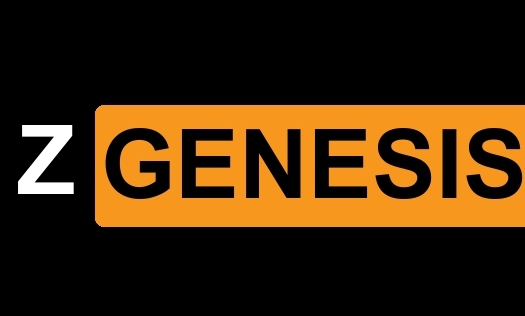

<div align="center">

  

  # 🎬 ZGENESIS

  ### Discover, search and resolve video links.

  **A Node.js and Express-powered video catalogue and link-resolver application by DEV ZIKKY TECH.**

  <p>
    
    
    
    
    <a href="LICENSE"></a>
  </p>

  <p>
    <a href="https://zgenesis.vercel.app/">🌐 Live Website</a>
    · <a href="https://zgenesis.vercel.app/api">📖 API Documentation</a>
    · <a href="https://zgenesis.vercel.app/ping">💚 Health Check</a>
    · <a href="https://github.com/zikky0001-droid/zgenesis">💻 GitHub Repository</a>
  </p>

  **DISCOVER · SEARCH · WATCH · RESOLVE**

</div>

---

## ✨ About ZGenesis

**ZGenesis** is a video catalogue and video-link resolver built with **Node.js 22** and **Express**. It provides a browser-based interface for discovering and searching videos, viewing video information, and resolving supported video-page URLs into stream and download links.

The application combines a static frontend with an Express backend. The backend communicates with configured upstream services, validates supported video domains, caches selected responses, and exposes both website-facing endpoints and a versioned public API.

The production application is deployed at **[zgenesis.vercel.app](https://zgenesis.vercel.app/)**.

## 🌐 Live application

| Resource | URL |
|---|---|
| Main website | [https://zgenesis.vercel.app/](https://zgenesis.vercel.app/) |
| Video page | [https://zgenesis.vercel.app/video](https://zgenesis.vercel.app/video) |
| API documentation | [https://zgenesis.vercel.app/api](https://zgenesis.vercel.app/api) |
| Health check | [https://zgenesis.vercel.app/ping](https://zgenesis.vercel.app/ping) |
| API configuration | [https://zgenesis.vercel.app/api/config](https://zgenesis.vercel.app/api/config) |
| Not-found page | [https://zgenesis.vercel.app/404](https://zgenesis.vercel.app/404) |

## 🚀 Features

### 🎞️ Video discovery

- Homepage video catalogue.
- Search by video title or supported search query.
- Video detail lookup by ID.
- Video detail lookup using a supported video-page URL.
- Stream-link resolution.
- Download-link resolution.
- Dedicated video player page.

### 🔌 Developer API

- Website-facing JSON endpoints.
- Versioned `/api/v1/*` endpoints.
- Search, video details, stream and download resolution.
- API status and rate-limit information.
- Consistent JSON response formatting.
- Structured error responses for versioned API routes.
- API documentation page with request examples.

### ⚡ Backend behaviour

- Express-based HTTP application.
- Axios-powered upstream requests.
- 60-second in-memory response cache.
- Lazy cache cleanup triggered by incoming requests; no periodic cleanup job is required.
- Request-level timeout and cancellation handling for supported outbound operations.
- Supported-domain validation based on `SUPPORTED_DOMAINS`.
- Configurable upstream URLs through the existing application environment variables.
- Compression, Helmet security headers and CORS middleware.

### 🧭 Website routing

| Route | Page or behaviour |
|---|---|
| `/` | Homepage (`index.html`) |
| `/index` | Homepage |
| `/index.html` | Homepage |
| `/api` | API documentation (`api.html`) |
| `/api.html` | API documentation |
| `/api-docs` | API documentation |
| `/video` | Video page (`video.html`) |
| `/video.html` | Video page |
| `/404` | Branded not-found page |
| `/icon.jpg` | Application preview image |
| `/script.js` | Frontend JavaScript asset |

Unknown website routes display the branded `404.html` page and return HTTP `404`. Unknown `/api/*` routes return a JSON `404` response rather than the website's HTML error page.

## 🧩 Application architecture

```text
                    Visitor / API Client
                            |
                            v
                 ZGenesis Website / API
                            |
                            v
                     Express Server
                            |
            +---------------+----------------+
            |               |                |
            v               v                v
       Static Pages    Website APIs     Public API
       public/         /api/*            /api/v1/*
                            |                |
                            +--------+-------+
                                     |
                                     v
                           Upstream URL resolver
                                     |
                    +----------------+----------------+
                    |                |                |
                    v                v                v
                 BASE_URL        SEARCH_URL        VIDEO_URL
                    |                |                |
                    +----------------+----------------+
                                     |
                                     v
                           Supported-domain checks
                                     |
                                     v
                         Response cache / resolver
```

The upstream services and supported video hosts are controlled by the configured environment values. The application does not require a hard-coded deployment-specific upstream URL when the corresponding environment variable is provided.

## 🔌 API reference

The live **[API documentation](https://zgenesis.vercel.app/api)** is the primary interactive reference. The following table summarizes the routes implemented by the application.

### Health and configuration

| Method | Endpoint | Description |
|---|---|---|
| `GET` | `/ping` | Server health and runtime information |
| `GET` | `/api/config` | Returns the configured public API base URL |
| `GET` | `/api/v1/status` | Public API status |
| `GET` | `/api/v1/limits` | Current rate-limit information |

### Website-facing API

| Method | Endpoint | Description |
|---|---|---|
| `GET` | `/api/home` | Retrieve homepage videos |
| `GET` | `/api/search?q=...` | Search videos |
| `GET` | `/api/video/by-url?url=...` | Resolve video details from a supported page URL |
| `GET` | `/api/video/:id` | Retrieve video details by ID |
| `GET` | `/api/stream/:id` | Stream a video by ID |
| `GET` | `/api/download/:id` | Download a video by ID |

### Versioned public API

Only the `/api/v1/*` route group is subject to the application's Redis-backed rate limiter.

| Method | Endpoint | Required parameter | Description |
|---|---|---|---|
| `GET` | `/api/v1/status` | — | API status |
| `GET` | `/api/v1/limits` | — | Rate-limit usage and backend status |
| `GET` | `/api/v1/search` | `q` | Search videos |
| `GET` | `/api/v1/video` | `url` | Retrieve video details |
| `GET` | `/api/v1/stream` | `url` | Resolve a stream URL |
| `GET` | `/api/v1/download` | `url` | Resolve a download URL |

Example search request:

```bash
curl "https://zgenesis.vercel.app/api/v1/search?q=one%20piece"
```

Example video lookup:

```bash
curl "https://zgenesis.vercel.app/api/v1/video?url=ENCODED_VIDEO_PAGE_URL"
```

Example stream lookup:

```bash
curl "https://zgenesis.vercel.app/api/v1/stream?url=ENCODED_VIDEO_PAGE_URL"
```

Example download lookup:

```bash
curl "https://zgenesis.vercel.app/api/v1/download?url=ENCODED_VIDEO_PAGE_URL"
```

To redirect a browser to the resolved upstream download URL, use `redirect=true`:

```text
/api/v1/download?url=ENCODED_VIDEO_PAGE_URL&redirect=true
```

Use URL encoding when passing a complete video-page URL as a query parameter.

## 🚦 Rate limiting

The versioned public API uses Upstash Redis through its REST interface. The configured limits are per IP address:

| Limit | Maximum | Window |
|---|---:|---|
| Short window | 40 requests | 1 minute |
| Hourly window | 2,500 requests | 1 hour |

The rate-limit check uses an atomic Redis Lua operation so concurrent requests cannot independently increment the counters in a way that bypasses the configured limits.

**Scope:** the limiter is mounted on `/api/v1/*`. Website-facing endpoints such as `/api/home` and `/api/search` are outside this limiter.

**Redis outage behaviour:** the application is configured to fail open. If Redis is unavailable or its credentials are missing, requests are allowed to continue and the rate-limit protection is temporarily unavailable. Redis errors are logged with sensitive credentials and visitor details excluded. Routine Redis success messages are not emitted by default.

### Redis key isolation

ZGenesis uses its own Redis key namespace:

```text
the-genesis:ratelimit:v1:
```

This keeps ZGenesis counters separate from keys belonging to other applications that may use the same Redis database. ZGenesis does not need to read, modify or delete another application's keys.

## ⚙️ Environment configuration

The application uses the following five application environment variables. Configure them in **Vercel → Project Settings → Environment Variables** using the values from your existing deployment.

| Variable | Purpose |
|---|---|
| `API_URL` | Public application URL. Defaults to `https://zgenesis.vercel.app`. |
| `BASE_URL` | Upstream base/catalogue URL. |
| `SEARCH_URL` | Upstream search URL. |
| `VIDEO_URL` | Upstream video-page URL prefix. |
| `SUPPORTED_DOMAINS` | Comma-separated list of supported video hostnames. |

The application also reads these two infrastructure credentials for shared rate limiting:

| Variable | Purpose |
|---|---|
| `UPSTASH_REDIS_REST_URL` | Upstash Redis REST endpoint. |
| `UPSTASH_REDIS_REST_TOKEN` | Authentication token for the Upstash REST endpoint. |

The Redis variables are infrastructure credentials, not replacements for the five application settings. Keep all credentials private and never place them in frontend JavaScript, HTML, screenshots or public commits.

**No `HOST_REWRITES` environment variable is required by this configuration.**

## 🪵 Logging and diagnostics

The source contains a `DEBUG_LOGS` setting near the top of `server.js`.

```js
const DEBUG_LOGS = false;
```

- `false` (default): suppresses routine diagnostic output while errors continue to be logged.
- `true`: enables additional diagnostic information useful when investigating requests and upstream behaviour.

Debug output is intended for server-side logs. Sensitive values such as Redis credentials should not be printed.

## ⚡ Cache and request handling

- Cache time-to-live: **60 seconds**.
- Expired cache entries are cleaned lazily when requests arrive.
- No Cron job or repeating background cache-cleanup interval is required.
- The application uses a request-level deadline for supported outbound work.
- Upstream requests and retries are designed to respect cancellation when the request deadline is reached.
- The in-memory cache is local to a running function instance. It is temporary and is not permanent application storage.

## 🖥️ Technology stack

| Layer | Technology |
|---|---|
| Runtime | Node.js 22 |
| Backend | Express 4 |
| HTTP client | Axios |
| Security headers | Helmet |
| Cross-origin support | CORS |
| Compression | Express compression middleware |
| Rate-limit storage | Upstash Redis REST API |
| Frontend | HTML, CSS and vanilla JavaScript |
| Hosting | Vercel |

## 🗂️ Repository structure

```text
zgenesis/
├── .env.example
├── .gitignore
├── LICENSE
├── README.md
├── package.json
├── vercel.json
├── server.js
└── public/
    ├── index.html
    ├── api.html
    ├── video.html
    ├── 404.html
    ├── script.js
    └── icon.jpg
```

The `public/` directory contains the browser-facing pages and static assets. The Express application handles dynamic API routes and page aliases.

## 🚀 Deploying to Vercel

### Requirements

- A GitHub repository containing the project.
- A Vercel account and project connected to the repository.
- Node.js 22 runtime support.
- The five application environment variables listed above.
- Upstash Redis REST URL and token for shared rate-limit counters.

### Deployment steps

1. Push the project to GitHub.
2. Import the repository into Vercel.
3. Set the project root directory to the repository root.
4. Configure the five application environment variables with the same values used by the existing deployment.
5. Configure `UPSTASH_REDIS_REST_URL` and `UPSTASH_REDIS_REST_TOKEN` if Redis-backed rate limiting is required.
6. Confirm the production domain is `https://zgenesis.vercel.app`.
7. Deploy the project.
8. Check `/ping`, `/`, `/api`, `/video` and the versioned API endpoints.

The supplied `vercel.json` configures the Express function with a maximum duration of 180 seconds and includes the `public/` directory in the function bundle.

## 💻 Local development

Install dependencies:

```bash
npm install
```

Create a local `.env` file using `.env.example` as a reference, then add the appropriate values.

Start the application:

```bash
npm start
```

For development with automatic restarts:

```bash
npm run dev
```

The local server uses the same Express routes. Redis credentials are optional for local development; when they are not configured, the local rate limiter uses its process-local fallback.

## 🔐 Security and operational notes

- Keep environment variables and service credentials private.
- Do not commit `.env` files.
- Do not expose Redis tokens in browser code.
- Supported video domains are validated against `SUPPORTED_DOMAINS`.
- The versioned API rate limiter is separate from the website-facing API routes.
- Redis fail-open behaviour preserves request availability but means rate limiting is not enforced during a Redis outage.
- The in-memory cache is temporary and should not be treated as durable storage.
- A successful stream or download URL may be time-limited by the upstream provider.
- Use the health endpoint and Vercel Function Logs when diagnosing deployment or upstream errors.

## 📜 License

This project is distributed under the **MIT License**. See [`LICENSE`](LICENSE) for the full license text.

## 👨‍💻 Maintainer

**DEV ZIKKY — DEVZIKKY TECH**

- GitHub: [@zikky0001-droid](https://github.com/zikky0001-droid)
- Repository: [zgenesis](https://github.com/zikky0001-droid/zgenesis)
- Website: [zgenesis.vercel.app](https://zgenesis.vercel.app/)

---

<div align="center">

  ### 🎬 DISCOVER. SEARCH. WATCH. RESOLVE.

  **ZGENESIS · A DEVZIKKY TECH PROJECT**

</div>
